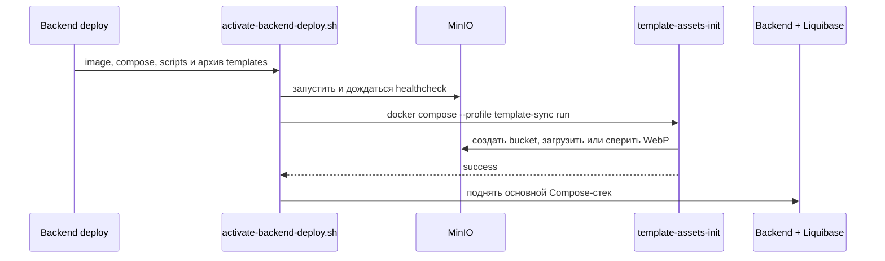

# Публикация reference-файлов шаблонов в MinIO

Читай при добавлении или замене reference-файла шаблона, а также при изменении
backend deployment. Этот документ описывает одноразовый Compose job
`template-assets-init`; по роли он является init container, хотя в Compose это
отдельно запускаемый контейнер, а не сервис основного стека.

## 1. Что публикуется

- Исходные файлы хранятся в репозитории: `assets/templates/<templateId>/<file>.webp`.
- Job загружает их в bucket из `MINIO_BUCKET` под ключами
  `templates/<templateId>/<file>.webp`.
- В Liquibase metadata `storage_key` должен в точности совпадать с этим ключом.
  Изображение, Asset и связь шаблона публикуются одной новой миграцией по
  [MIGRATIONS.md](MIGRATIONS.md).
- Job относится только к backend deployment. Обычный UI deployment его не запускает.

## 2. Порядок backend deployment

Точка завершения deployment — [deploy/activate-backend-deploy.sh](../../deploy/activate-backend-deploy.sh).
Её вызывают локальный backend deployment и будущий GitHub Actions deployment.
Скрипт распаковывает `template-assets.tar.gz` во временный каталог, заменяет
staging-каталог `template-assets/` на сервере, загружает образ и затем:

1. запускает только MinIO;
2. выполняет `template-assets-init` с профилем `template-sync`;
3. запускает основной Compose-стек, где приложение применяет Liquibase-миграции.

Если job завершается с ошибкой, третий шаг не выполняется: новая миграция не
сделает шаблон доступным без его reference-файла.

Состав job задан в [deploy/docker-compose.prod.yml](../../deploy/docker-compose.prod.yml),
а его логика — в [deploy/sync-template-assets.sh](../../deploy/sync-template-assets.sh).
Конфигурация MinIO передаётся Compose из production environment; не читай и не
копируй `.env` или файлы Compose secrets.

## 3. Правила синхронизации

- Job создаёт bucket, если его ещё нет.
- Для каждого нового WebP выставляется `Content-Type=image/webp`.
- Существующий объект не перезаписывается. Job скачивает его, сравнивает SHA-256
  с файлом из Git и продолжает работу только при полном совпадении.
- Job не удаляет объекты из bucket, даже если исходный файл больше не находится
  в архиве deployment.
- Отсутствие хотя бы одного `*.webp` в staging-каталоге считается ошибкой deployment.

Такое поведение сохраняет воспроизводимость snapshots уже созданных карточек и
исключает рассогласование между миграцией и binary в MinIO.

## 4. Как добавить или заменить reference

### Новый шаблон

1. Добавь финальный WebP в `assets/templates/<templateId>/`.
2. Создай новую Liquibase-миграцию с Asset и ключом
   `templates/<templateId>/<file>.webp`; включи changeset в master.
3. Проверь, что ключ migration совпадает с путём файла.
4. Выполни backend deployment. Job опубликует файл до запуска Spring приложения.

### Замена опубликованного reference

1. Создай новый WebP с новым именем и, следовательно, новым object key.
2. Добавь новый Asset и новую миграцию, переключающую `reference_asset_id` шаблона.
3. Оставь старый объект и старый Asset доступными для существующих jobs и snapshots.

Нельзя менять bytes в опубликованном ключе. Несовпадение SHA-256 намеренно
останавливает deployment; исправление состоит в новом ключе и новой миграции,
а не в отключении проверки.

## 5. Операционные правила

- Не публикуй reference вручную через MinIO Console или `mc` в стандартном
  сценарии: следующий backend deployment обязан подтвердить содержимое объекта.
- Не запускай основной production Compose вручную для публикации нового шаблона.
  Используй общий activation script, чтобы job завершился до Liquibase.
- При ошибке `Template object differs from the committed reference` проверь,
  что для изменённого изображения создано новое имя файла и новая миграция.
- При ошибке отсутствия WebP проверь содержимое `assets/templates/` и архив,
  который формирует вызывающий deployment script.

Подготовка authoring-файлов описана в
[assets/templates/README.md](../../assets/templates/README.md).
