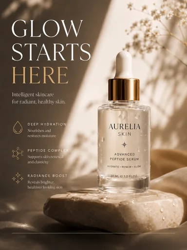

# Шаблон «Beauty podium»

Готовый reference для существующего `tpl_beauty_accent` в категории **«Красота и уход»** (`cat_beauty`, `sort_order=20`). Миграции `038-beauty-podium-template` и `039-beauty-podium-variants` связывают изображение, recipe и десять сценариев с шаблоном, сохраняя его категорию и порядок.

| Параметр | Значение |
| --- | --- |
| Файл для загрузки | `assets/templates/tpl_beauty_accent/18a87b87-a0ab-4db7-92e1-a430f8d0d252.webp` |
| Bucket в MinIO | `user-images` по умолчанию; если задан `MINIO_BUCKET`, использовать его значение |
| Ключ объекта в MinIO | `templates/tpl_beauty_accent/18a87b87-a0ab-4db7-92e1-a430f8d0d252.webp` |
| Content-Type | `image/webp` |
| Размер | `384×512`, `23064` байта (около `23 КиБ`) |
| Asset ID | `asset_tpl_beauty_accent_ref` |
| Template ID | `tpl_beauty_accent` |
| Recipe и метаданные | [Миграция 038](../../../src/main/resources/db/changelog/changes/038-beauty-podium-template.yaml) |
| Варианты 1–10 | [card-variants.json](card-variants.json), [миграция 039](../../../src/main/resources/db/changelog/changes/039-beauty-podium-variants.yaml) |

Изображение получено из загруженного пользователем PNG: кадрирование под вертикальную карточку и сжатие в WebP с UUID в имени. Оно используется и для превью, и как визуальный образец при генерации. Сцена — тёплый солнечный свет, каменный подиум и крупный заголовок слева от товара.

## Как подключить и проверить

1. До применения миграции загрузить WebP в bucket приложения по точному ключу `templates/tpl_beauty_accent/18a87b87-a0ab-4db7-92e1-a430f8d0d252.webp` с Content-Type `image/webp`. Префикс `assets/` и имя bucket в ключ не входят.
2. Запустить приложение с Liquibase. Миграция `038` создаст запись `assets` и обновит существующий шаблон; `039` добавит десять вариантов.
3. Открыть категорию «Красота и уход» или вызвать `GET /api/v1/templates?categoryId=cat_beauty`; у шаблона «Beauty podium» должно появиться превью.
4. В режиме `OPENAI_MODE=live` проверить генерацию с собственным фото товара. Результат должен сохранить упаковку, реальные цвета, бренд и видимые надписи исходного товара.

Бренд, слоган, peptide complex, обещания увлажнения и сияния, объём `30 ml` и другие надписи на reference относятся только к демонстрационной сыворотке. Их место и типографика показывают верстку; текст для товара пользователя берётся лишь из его исходного фото и подтверждённого описания. Если сведений нет, соответствующий блок опускается.
