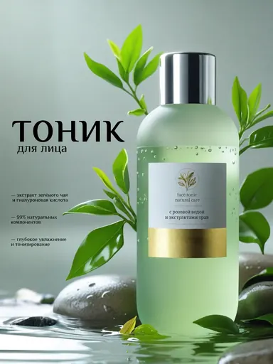

# Шаблон «Beauty clean»

Reference для существующего `tpl_beauty_hero` в категории **«Красота и уход»** (`cat_beauty`, порядок `10`). Миграция `036-beauty-clean-template` связывает изображение и обновляет общий recipe; `037-beauty-clean-variants` добавляет десять сценариев серии.

| Параметр | Значение |
| --- | --- |
| Файл для загрузки | `assets/templates/tpl_beauty_hero/6ddc1c1e-9730-44b5-8321-1595bf7fbd70.webp` |
| Bucket в MinIO | `user-images` по умолчанию; при заданном `MINIO_BUCKET` использовать его значение |
| Ключ объекта в MinIO | `templates/tpl_beauty_hero/6ddc1c1e-9730-44b5-8321-1595bf7fbd70.webp` |
| Content-Type | `image/webp` |
| Размер | `384×512`, `15986` байт (около `16 КиБ`) |
| Asset ID | `asset_tpl_beauty_hero_ref` |
| Template ID | `tpl_beauty_hero` |
| Recipe и метаданные | [Миграция 036](../../../src/main/resources/db/changelog/changes/036-beauty-clean-template.yaml) |
| Варианты 1–10 | [card-variants.json](card-variants.json), [миграция 037](../../../src/main/resources/db/changelog/changes/037-beauty-clean-variants.yaml) |

Reference уменьшен из предоставленного пользователем PNG и сохранён в WebP с UUID в имени. Исходный PNG в каталог не добавлен. На демонстрационном изображении видны флакон справа, зелень, влажные камни и текстовые блоки слева. Название, бренд, состав, процент натуральных компонентов и обещания эффекта на нём относятся только к демонстрационному товару. При генерации они заменяются подтверждёнными сведениями о товаре пользователя либо опускаются.

## Подключение

1. Backend-деплой автоматически синхронизирует WebP в bucket приложения по точному ключу `templates/tpl_beauty_hero/6ddc1c1e-9730-44b5-8321-1595bf7fbd70.webp` с Content-Type `image/webp`. В ключ не входят имя bucket и префикс `assets/`.
2. Запустить приложение с Liquibase: миграция `036` добавит asset и обновит существующий шаблон, миграция `037` добавит десять сценариев.
3. Открыть категорию «Красота и уход» или вызвать `GET /api/v1/templates?categoryId=cat_beauty` для просмотра превью.

Палитра и влажное окружение относятся к оформлению. Сохраняются реальные форма, цвет, бренд и видимые надписи исходного товара. Не следует переносить ингредиенты, проценты, объём или заявленные эффекты с демонстрационного флакона на другой товар.
