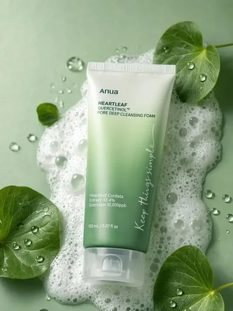

# Шаблон «Лёгкий lifestyle»

Reference для категории **«Красота и уход»** (`cat_beauty`). Шаблон `tpl_beauty_lifestyle` создан миграцией `010` с порядком `30`. Миграция `040-beauty-lifestyle-template` добавляет reference, меняет название на «Лёгкий lifestyle» и записывает общий recipe; `041-beauty-lifestyle-variants` добавляет десять сценариев серии.

| Параметр | Значение |
| --- | --- |
| Файл для загрузки | `assets/templates/tpl_beauty_lifestyle/a70ca180-c887-4e62-a18d-e33584f3664f.webp` |
| Bucket в MinIO | `user-images` по умолчанию; при заданном `MINIO_BUCKET` использовать его значение |
| Ключ объекта в MinIO | `templates/tpl_beauty_lifestyle/a70ca180-c887-4e62-a18d-e33584f3664f.webp` |
| Content-Type | `image/webp` |
| Размер | `384×512`, `23282` байта (около `23 КиБ`) |
| Asset ID | `asset_tpl_beauty_lifestyle_ref` |
| Template ID | `tpl_beauty_lifestyle` |
| Recipe и метаданные | [Миграция 040](../../../src/main/resources/db/changelog/changes/040-beauty-lifestyle-template.yaml) |
| Варианты 1–10 | [card-variants.json](card-variants.json), [миграция 041](../../../src/main/resources/db/changelog/changes/041-beauty-lifestyle-variants.yaml) |

Reference уменьшен из предоставленного пользователем JPEG до размера каталога и сохранён в WebP. Исходный JPEG в каталоге шаблона не хранится. Композиция использует мягкий зелёный фон, листья по краям, капли и крупный товар на переднем плане. Пена допустима лишь тогда, когда очищающее назначение исходного товара подтверждено; в других случаях остаётся спокойная зелёная поверхность.

## Подключение

1. Backend-деплой автоматически синхронизирует WebP в bucket приложения по точному ключу `templates/tpl_beauty_lifestyle/a70ca180-c887-4e62-a18d-e33584f3664f.webp` с Content-Type `image/webp`. В ключ не входят имя bucket и префикс `assets/`.
2. Запустить приложение с Liquibase: миграция `040` обновит шаблон и добавит asset, миграция `041` — десять сценариев.
3. Открыть категорию «Красота и уход» или вызвать `GET /api/v1/templates?categoryId=cat_beauty` для просмотра превью.

Демонстрационная упаковка и надписи показывают верстку, а не сведения о товаре пользователя. При генерации её заменяет исходный товар с сохранением формы, цвета, бренда и видимой маркировки. Название Anua, упоминания состава, проценты, объём, ретинол и другие заявления с reference не переносятся. Заголовки и характеристики заполняются только подтверждёнными данными пользователя, неподтверждённые блоки опускаются. Листья и капли не служат доказательством состава или действия средства.
