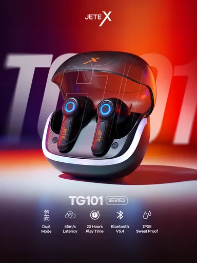

# Шаблон «Tech neon»

Готовый reference для существующего `tpl_electronics_accent` в категории **«Электроника и техника»** (`cat_electronics`, `sort_order=20`). Миграции `044-tech-neon-template` и `045-tech-neon-variants` связывают изображение, recipe и десять сценариев с шаблоном, сохраняя его категорию и порядок.

| Параметр | Значение |
| --- | --- |
| Файл для загрузки | `assets/templates/tpl_electronics_accent/1bf4e5e4-53fc-48aa-9276-90e8023b0b17.webp` |
| Bucket в MinIO | `user-images` по умолчанию; если задан `MINIO_BUCKET`, использовать его значение |
| Ключ объекта в MinIO | `templates/tpl_electronics_accent/1bf4e5e4-53fc-48aa-9276-90e8023b0b17.webp` |
| Content-Type | `image/webp` |
| Размер | `384×512`, `19018` байт (около `19 КиБ`) |
| Asset ID | `asset_tpl_electronics_accent_ref` |
| Template ID | `tpl_electronics_accent` |
| Recipe и метаданные | [Миграция 044](../../../src/main/resources/db/changelog/changes/044-tech-neon-template.yaml) |
| Варианты 1–10 | [card-variants.json](card-variants.json), [миграция 045](../../../src/main/resources/db/changelog/changes/045-tech-neon-variants.yaml) |

Изображение получено из загруженного пользователем PNG: кадрирование под вертикальную карточку и сжатие в WebP с UUID в имени. Оно служит превью и визуальным образцом при генерации. Сцена сохраняет красно-оранжевое неоновое освещение и фиолетовую глубину, крупный товар по центру, фоновую типографику и нижний ряд характеристик.

## Как подключить и проверить

1. Backend-деплой автоматически синхронизирует WebP в bucket приложения по точному ключу `templates/tpl_electronics_accent/1bf4e5e4-53fc-48aa-9276-90e8023b0b17.webp` с Content-Type `image/webp`. Префикс `assets/` и имя bucket в ключ не входят.
2. Подключить миграции `044` и `045` в `db.changelog-master.yaml` после предыдущих номеров и запустить приложение с Liquibase. `044` создаст запись `assets` и обновит шаблон; `045` добавит десять вариантов.
3. Открыть категорию «Электроника и техника» или вызвать `GET /api/v1/templates?categoryId=cat_electronics`; у «Tech neon» должно появиться превью.
4. В режиме `OPENAI_MODE=live` проверить генерацию с собственным фото товара. Результат должен сохранить его форму, реальные цвета, бренд и видимые надписи.

JETE, TG101, параметры задержки, времени работы, версии Bluetooth, защиты от влаги и другие надписи reference относятся только к демонстрационным наушникам. Их положение показывает верстку; для товара пользователя текст берётся только с исходного фото и из подтверждённого описания. Неподтверждённые блоки опускаются.
