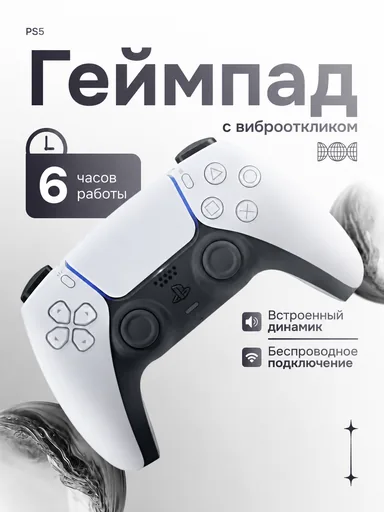

# Шаблон «Tech studio»

Reference для существующего `tpl_electronics_hero` в категории **«Электроника и техника»** (`cat_electronics`, порядок `10`). Миграция `042-tech-studio-template` связывает изображение и обновляет общий recipe; `043-tech-studio-variants` добавляет десять сценариев серии.

| Параметр | Значение |
| --- | --- |
| Файл для загрузки | `assets/templates/tpl_electronics_hero/dfb128d9-28d1-4c58-a4fd-1468a7eab7f9.webp` |
| Bucket в MinIO | `user-images` по умолчанию; при заданном `MINIO_BUCKET` использовать его значение |
| Ключ объекта в MinIO | `templates/tpl_electronics_hero/dfb128d9-28d1-4c58-a4fd-1468a7eab7f9.webp` |
| Content-Type | `image/webp` |
| Размер | `384×512`, `17286` байт (около `17 КиБ`) |
| Asset ID | `asset_tpl_electronics_hero_ref` |
| Template ID | `tpl_electronics_hero` |
| Recipe и метаданные | [Миграция 042](../../../src/main/resources/db/changelog/changes/042-tech-studio-template.yaml) |
| Варианты 1–10 | [card-variants.json](card-variants.json), [миграция 043](../../../src/main/resources/db/changelog/changes/043-tech-studio-variants.yaml) |

Reference подготовлен из предоставленного PNG: удалён случайный промоблок «Зарядка в подарок» с кабелями, область восстановлена как чистый светлый фон. Остались крупный диагональный геймпад, светлая студийная подача, заголовок, плашка и короткие функциональные подписи. Исходный PNG в каталог не добавлен.

PS5, «6 часов», виброотклик, встроенный динамик, беспроводное подключение и бренд на демонстрационной карточке относятся только к изображённому образцу. Для другого товара эти надписи и значки заменяются подтверждёнными сведениями пользователя либо опускаются. Сохраняются реальные форма, цвет, бренд и видимая маркировка исходного товара.

## Подключение

1. **До применения миграций** загрузить WebP в bucket приложения по точному ключу `templates/tpl_electronics_hero/dfb128d9-28d1-4c58-a4fd-1468a7eab7f9.webp` с Content-Type `image/webp`. В ключ не входят имя bucket и префикс `assets/`.
2. Запустить приложение с Liquibase: миграция `042` добавит asset и обновит существующий шаблон, миграция `043` добавит десять сценариев.
3. Открыть категорию «Электроника и техника» или вызвать `GET /api/v1/templates?categoryId=cat_electronics` для просмотра превью.

Миграции должны идти в порядке `042→043` после уже подготовленной серии `030–041`; порядок включения в master changelog согласуется с остальными шаблонами категории.
