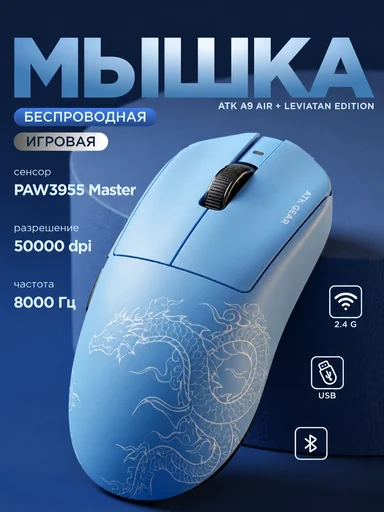

# Шаблон «Tech workspace»

Reference для категории **«Электроника и техника»** (`cat_electronics`). Шаблон `tpl_electronics_lifestyle` создан миграцией `010` с порядком `30`. Миграция `046-tech-workspace-template` добавляет reference и общий recipe; `047-tech-workspace-variants` добавляет десять сценариев серии.

| Параметр | Значение |
| --- | --- |
| Файл для загрузки | `assets/templates/tpl_electronics_lifestyle/ce3d7f9a-324e-422f-b3ee-43910340ccb7.webp` |
| Bucket в MinIO | `user-images` по умолчанию; при заданном `MINIO_BUCKET` использовать его значение |
| Ключ объекта в MinIO | `templates/tpl_electronics_lifestyle/ce3d7f9a-324e-422f-b3ee-43910340ccb7.webp` |
| Content-Type | `image/webp` |
| Размер | `384×512`, `27256` байт (около `27 КиБ`) |
| Asset ID | `asset_tpl_electronics_lifestyle_ref` |
| Template ID | `tpl_electronics_lifestyle` |
| Recipe и метаданные | [Миграция 046](../../../src/main/resources/db/changelog/changes/046-tech-workspace-template.yaml) |
| Варианты 1–10 | [card-variants.json](card-variants.json), [миграция 047](../../../src/main/resources/db/changelog/changes/047-tech-workspace-variants.yaml) |

Reference уменьшен из предоставленного PNG до размера каталога и сохранён в WebP; исходный PNG в каталоге шаблона не хранится. Изображение показывает синюю предметную студию с товаром крупно, огромным заголовком и блоками характеристик. Рабочее окружение в нём не выражено, поэтому сценарии используют только минимальную тёмно-синюю поверхность без вымышленных аксессуаров.

## Подключение

1. Backend-деплой автоматически синхронизирует WebP в bucket приложения по точному ключу `templates/tpl_electronics_lifestyle/ce3d7f9a-324e-422f-b3ee-43910340ccb7.webp` с Content-Type `image/webp`. В ключ не входят имя bucket и префикс `assets/`.
2. Запустить приложение с Liquibase: миграция `046` обновит шаблон и добавит asset, миграция `047` — десять сценариев.
3. Открыть категорию «Электроника и техника» или вызвать `GET /api/v1/templates?categoryId=cat_electronics` для просмотра превью.

Мышь ATK и её надписи служат демонстрацией верстки. При генерации её заменяет товар пользователя с сохранением формы, цвета, бренда и видимой маркировки. Названия ATK и A9 Air, сенсор PAW3955, значения 50000 dpi и 8000 Гц, а также иконки 2.4 G, USB и Bluetooth не переносятся как свойства нового товара. Текстовые блоки заполняются только подтверждёнными сведениями; неподтверждённые блоки опускаются. Синий свет и фон не меняют реальный цвет товара.
