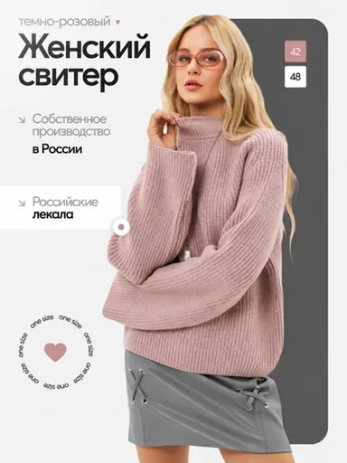

# Шаблон «Крупный заголовок и акценты»

Готовый reference для существующего `tpl_fashion_accent` в категории **«Одежда и обувь»** (`cat_fashion`). Миграции `024-fashion-accent-template` и `025-fashion-accent-variants` связывают изображение, recipe и десять сценариев с шаблоном, сохраняя его категорию и порядок.

| Параметр | Значение |
| --- | --- |
| Файл для загрузки | `assets/templates/tpl_fashion_accent/3989ac29-8894-40ec-9080-e8527193e47e.webp` |
| Bucket в MinIO | `user-images` по умолчанию; если задан `MINIO_BUCKET`, использовать его значение |
| Ключ объекта в MinIO | `templates/tpl_fashion_accent/3989ac29-8894-40ec-9080-e8527193e47e.webp` |
| Content-Type | `image/webp` |
| Размер | `384×512`, `22806` байт (около `22 КиБ`) |
| Asset ID | `asset_tpl_fashion_accent_ref` |
| Template ID | `tpl_fashion_accent` |
| Recipe и метаданные | [Миграция 024](../../../src/main/resources/db/changelog/changes/024-fashion-accent-template.yaml) |
| Варианты 1–10 | [card-variants.json](card-variants.json), [миграция 025](../../../src/main/resources/db/changelog/changes/025-fashion-accent-variants.yaml) |

Изображение получено из загруженного пользователем JPEG: удалена надпись «Подробнее →», результат уменьшен до размера каталога и сохранён в WebP с UUID в имени файла. Оно используется и для превью, и как визуальный образец при генерации.

## Как подключить и проверить

1. Backend-деплой автоматически синхронизирует указанный WebP в bucket приложения по точному ключу `templates/tpl_fashion_accent/3989ac29-8894-40ec-9080-e8527193e47e.webp`. Префикс `assets/` и имя bucket в ключ не входят.
2. Запустить приложение с Liquibase. Миграция `024` создаст запись `assets` и обновит существующий шаблон; `025` добавит десять вариантов.
3. Открыть категорию «Одежда и обувь» или вызвать `GET /api/v1/templates?categoryId=cat_fashion`; у шаблона «Крупный заголовок и акценты» должно появиться превью.
4. В режиме `OPENAI_MODE=live` проверить генерацию с собственным фото товара. Результат должен использовать композицию и оформление reference, сохраняя реальные свойства товара пользователя.

Надписи, модель, размеры `42` и `48`, цвет, «one size», заявления о производстве и лекалах относятся только к демонстрационному товару на reference. При генерации текст заменяется подтверждёнными сведениями о товаре пользователя; неподтверждённые блоки опускаются. Человек не добавляется, если его нет на исходном фото.
