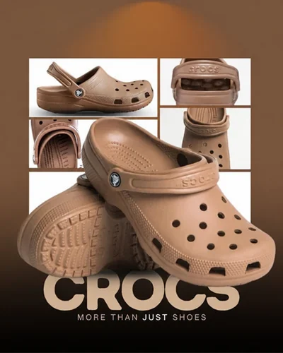

# Шаблон «Кофейный коллаж»

Новый шаблон `tpl_fashion_collage` в категории **«Одежда и обувь»** (`cat_fashion`), порядок `70`. Reference сохраняет кофейный градиент, белую плиточную сетку и кремовую редакционную типографику исходного макета.



| Параметр | Значение |
| --- | --- |
| Template ID | `tpl_fashion_collage` |
| Название | Кофейный коллаж |
| Категория | `cat_fashion` — Одежда и обувь |
| Порядок | `70` |
| Файл | `assets/templates/tpl_fashion_collage/71d4c8b0-09bf-4c74-b04e-e74d4499e5ea.webp` |
| Ключ объекта | `templates/tpl_fashion_collage/71d4c8b0-09bf-4c74-b04e-e74d4499e5ea.webp` |
| Content-Type | `image/webp` |
| Размер | `400×500`, `22168` байт (около `21,65 КиБ`) |
| Asset ID | `asset_tpl_fashion_collage_ref` |
| Recipe | [recipe.json](recipe.json), schemaVersion `1` |
| Метаданные и recipe | [Миграция 078](../../../src/main/resources/db/changelog/changes/078-fashion-footwear-templates.yaml) |
| Сценарии | [card-variants.json](card-variants.json), [миграция 079](../../../src/main/resources/db/changelog/changes/079-fashion-footwear-variants.yaml) |

Приложенный пользователем PNG «Коллаж бежевых Crocs на коричневом фоне.png» `1122×1402` детерминированно уменьшен Pillow LANCZOS до `400×500` без обрезки; пропорции сохранены с округлением до целых пикселей. WebP quality `86`, method `6`. Он заменяет первоначальный reference с тем же UUID и ключом до первого применения миграции `078`. Дополнительное изображение не генерировалось. Тот же файл используется для превью и reference генерации.

Надписи, бренд, демонстрационные ракурсы и заявления о свойствах относятся только к reference. В карточке нового товара overlay-текст заменяется подтверждёнными сведениями. Бренд и видимые надписи самого исходного товара сохраняются. Коллаж использует только реально различимые области исходного фото: дополнительные ракурсы, пара обуви и предметы комплекта не создаются ради заполнения сетки. При недостатке данных плитки сокращаются или остаются декоративными.

## Десять сценариев

| № | Сценарий | Кадрирование |
| --- | --- | --- |
| 1 | Обложка-коллаж | Товар целиком |
| 2 | Особенности по пунктам | Товар целиком |
| 3 | Силуэт на светлом | Товар целиком |
| 4 | Фактура крупным планом | Различимая деталь; иначе товар целиком |
| 5 | Деталь конструкции | Различимая деталь; иначе товар целиком |
| 6 | Цвет и отделка | Товар целиком |
| 7 | Принт или маркировка | Различимая деталь; иначе товар целиком |
| 8 | Паспорт товара | Товар целиком |
| 9 | Один главный факт | Товар целиком |
| 10 | Финальный акцент | Товар целиком |

Крупные планы допустимы только для различимых областей исходного фото; у каждого сценария предусмотрена запасная композиция. Текст и товар сохраняют поля не менее 5% от каждого края.

## Проверка и подключение

Локальная проверка authoring-данных:

```sh
python3 scripts/seed-card-variants.py --check --source assets/templates/tpl_fashion_collage/card-variants.json
```

Формат, размеры и фактический объём WebP проверены локально. Backend-деплой синхронизирует reference по указанному ключу с Content-Type `image/webp` до применения общей миграции `078`; `079` добавляет десять сценариев. В ключ не входят имя bucket и префикс `assets/`. Ручная загрузка в MinIO и применение миграций к БД при подготовке не выполнялись.

После деплоя проверить превью в категории «Одежда и обувь» и генерацию для `1:1`, `3:4`, `4:5`, `16:9`, включая сохранение товара и замену демонстрационного текста. Эти runtime-проверки локальная подготовка файлов не подтверждает.
