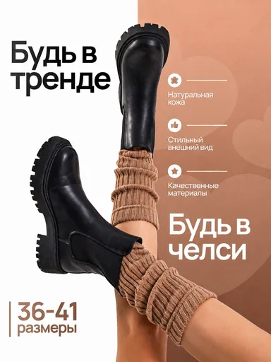

# Шаблон «Контрастный силуэт»

Reference для категории **«Одежда и обувь»** (`cat_fashion`). Миграция `026-fashion-contrast-template` добавляет шаблон `tpl_fashion_contrast` с порядком `40` и общим recipe; `027-fashion-contrast-variants` добавляет десять сценариев серии.

| Параметр | Значение |
| --- | --- |
| Файл для загрузки | `assets/templates/tpl_fashion_contrast/69e9ffa5-dc91-41ec-b346-ec33a0bbf708.webp` |
| Bucket в MinIO | `user-images` по умолчанию; при заданном `MINIO_BUCKET` использовать его значение |
| Ключ объекта в MinIO | `templates/tpl_fashion_contrast/69e9ffa5-dc91-41ec-b346-ec33a0bbf708.webp` |
| Content-Type | `image/webp` |
| Размер | `384×512`, `22384` байта (около `22 КиБ`) |
| Asset ID | `asset_tpl_fashion_contrast_ref` |
| Template ID | `tpl_fashion_contrast` |
| Recipe и метаданные | [Миграция 026](../../../src/main/resources/db/changelog/changes/026-fashion-contrast-template.yaml) |
| Варианты 1–10 | [card-variants.json](card-variants.json), [миграция 027](../../../src/main/resources/db/changelog/changes/027-fashion-contrast-variants.yaml) |

Изображение подготовлено из предоставленного пользователем макета: кадр центрирован до пропорции `3:4`, уменьшен и сохранён в WebP. Исходный PNG не хранится в каталоге шаблона.

## Подключение

1. Backend-деплой автоматически синхронизирует указанный WebP в bucket приложения по точному ключу `templates/tpl_fashion_contrast/69e9ffa5-dc91-41ec-b346-ec33a0bbf708.webp` с Content-Type `image/webp`. В ключ не входят имя bucket и префикс `assets/`.
2. Запустить приложение с Liquibase: миграция `026` добавит asset и шаблон, миграция `027` — десять сценариев.
3. Открыть категорию «Одежда и обувь» или вызвать `GET /api/v1/templates?categoryId=cat_fashion` для просмотра превью.

Демонстрационные ботинки, ноги, носки, надписи «Будь в тренде», «Будь в челси», размерный ряд и заявления о материале относятся только к reference. При генерации товар и наложенный текст должны заменяться по исходному фото и подтверждённому описанию пользователя; неподтверждённые блоки опускаются. Человек или часть тела не добавляются, если их нет на исходном фото.
