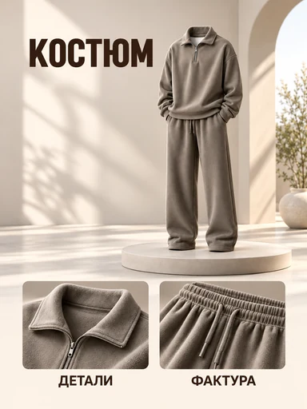

# Пример шаблона «Крупный заголовок и характеристики»

Готовый пример для категории **«Одежда и обувь»** (`cat_fashion`). Миграция `011-fashion-template-example` заменяет заглушку существующего `tpl_fashion_hero`, сохраняя его категорию и порядок; миграция `068-fashion-hero-reference-v3` переключает его на текущий reference. Остальные шаблоны она не изменяет.



| Параметр | Значение |
| --- | --- |
| Файл для загрузки | `assets/templates/tpl_fashion_hero/reference-v3.webp` |
| Bucket в MinIO | `user-images` по умолчанию; если задан `MINIO_BUCKET`, использовать его значение |
| Ключ объекта в MinIO | `templates/tpl_fashion_hero/reference-v3.webp` |
| Content-Type | `image/webp` |
| Размер | `384×512`, `26576` байт (около `26 КиБ`) |
| Asset ID | `asset_tpl_fashion_hero_ref_v3` |
| Template ID | `tpl_fashion_hero` |
| Recipe и метаданные | [Миграция 068](../../../src/main/resources/db/changelog/changes/068-fashion-hero-reference-v3.yaml) |
| Сценарии серии | [Миграция 069](../../../src/main/resources/db/changelog/changes/069-fashion-hero-variants-v3.yaml) |

При стандартной конфигурации полный путь: `user-images/templates/tpl_fashion_hero/reference-v3.webp`. Здесь `user-images` — bucket, а `templates/tpl_fashion_hero/reference-v3.webp` — ключ объекта внутри него. Bucket задаётся настройкой `tovarika.storage.minio.bucket` через переменную `MINIO_BUCKET`; значение по умолчанию `user-images` одинаково для локального запуска и обоих Compose-файлов.

## Логическое разделение внутри bucket

В одном bucket используются отдельные папки для исходных фото, готовых карточек и шаблонов:

```text
user-images/
├── products/                         # исходные фотографии товаров пользователей
├── cards/                            # сгенерированные карточки
└── templates/                        # изображения шаблонов
    └── tpl_fashion_hero/
        └── reference-v3.webp
```

В MinIO папки отображаются по префиксам ключей объектов. Sync job загружает файл с ключом `templates/tpl_fashion_hero/reference-v3.webp` в соответствующий префикс; папки создавать отдельно не требуется.

Такое разделение уже предусмотрено: приложение записывает исходные фото в `products/`, результаты генерации — в `cards/`, а миграция примера ссылается на `templates/`.

## Как посмотреть в приложении

1. При backend-деплое `template-assets-init` синхронизирует `reference-v3.webp` с bucket `user-images` (или переопределённым через `MINIO_BUCKET`) по ключу `templates/tpl_fashion_hero/reference-v3.webp`. Префикс `assets/` и имя bucket в ключ объекта не входят.
2. Запустить обновлённое приложение: Liquibase применит миграцию `068-fashion-hero-reference-v3`, свяжет новый Asset с существующим шаблоном и миграцией `069-fashion-hero-variants-v3` обновит сценарии серии.
3. Открыть категорию «Одежда и обувь». У шаблона «Крупный заголовок и характеристики» появится это превью. Через API его можно найти запросом `GET /api/v1/templates?categoryId=cat_fashion`.
4. Загрузить собственное фото товара, дождаться анализа, проверить и при необходимости исправить описание, затем выбрать этот шаблон и создать карточку.

Для проверки реальной генерации приложение должно работать с настроенным `OPENAI_MODE=live`. В режиме `stub` каталог покажет загруженное превью, но результат генерации останется тестовой заглушкой.

Надписи «КОСТЮМ», «ДЕТАЛИ», «ФАКТУРА» и изображения деталей — демонстрационное
содержимое reference. При генерации текстовые блоки заменяются данными товара
пользователя; неподтверждённые блоки опускаются. Детали из примера не добавляются,
если они не различимы на исходном фото пользователя.

## Подготовленные сценарии серии

[card-variants.json](card-variants.json) содержит 10 вариантов: первую обложку и девять
следующих карточек, с пользовательскими идеями, композициями и условиями показа деталей.
Runtime загружает сценарии из БД. Миграция `069` синхронизирует первую обложку с новым
reference; уже созданные серии используют сохранённый snapshot. JSON не заменяет общий
recipe миграции `068`.

Устройство хранения, наполнения, API и UI, а также критерии проверки описаны в
[задачах серии карточек](../../../docs/card-series-tasks.md).

[generation-prompt-v3.txt](generation-prompt-v3.txt) описывает подготовку текущего
изображения. [generation-prompt.txt](generation-prompt.txt) относится к прежнему
`reference.webp`. Рабочий recipe для текущего изображения находится в миграции `068`.
Прежние WebP и Asset сохранены для ранее созданных карточек и snapshots.
