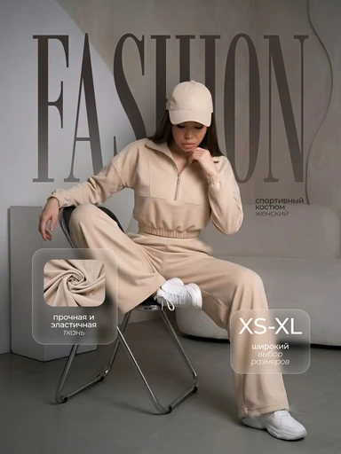

# Шаблон «Fashion lifestyle»

Reference для существующего `tpl_fashion_lifestyle` в категории **«Одежда и обувь»** (`cat_fashion`, порядок `30`). Миграция `070-fashion-lifestyle-template` добавляет reference и общий recipe; `071-fashion-lifestyle-variants` добавляет десять сценариев серии.



| Параметр | Значение |
| --- | --- |
| Файл для загрузки | `assets/templates/tpl_fashion_lifestyle/d69936bc-760f-49f8-a8b4-714d4889f643.webp` |
| Bucket в MinIO | `user-images` по умолчанию; переопределяется `MINIO_BUCKET` |
| Ключ объекта | `templates/tpl_fashion_lifestyle/d69936bc-760f-49f8-a8b4-714d4889f643.webp` |
| Content-Type | `image/webp` |
| Размер | `384×512`, `24264` байта |
| Asset ID | `asset_tpl_fashion_lifestyle_ref` |
| Template ID | `tpl_fashion_lifestyle` |
| Recipe и метаданные | [Миграция 070](../../../src/main/resources/db/changelog/changes/070-fashion-lifestyle-template.yaml) |
| Варианты 1–10 | [card-variants.json](card-variants.json), [миграция 071](../../../src/main/resources/db/changelog/changes/071-fashion-lifestyle-variants.yaml) |

Reference преобразован из предоставленного пользователем JPEG без удаления надписей. Сохранены крупный заголовок `FASHION`, подписи и размеры на стеклянных плашках, интерьер, модель и тканевый фрагмент. Для полного кадра достаточно изменения размера и формата до WebP. Файл используется и как превью, и как второй вход генерации. Демонстрационные модель, костюм, цвет, фактура и размер не являются данными нового товара.

## Общий recipe

```json
{
  "schemaVersion": 1,
  "scene": "Understated interior studio with a neutral wall, soft geometric furniture and gray floor",
  "composition": "Source product large at center; free wall space for a tall headline and two rounded translucent fact panels below",
  "lighting": "Soft diffused studio light, natural shadows and visible product texture",
  "style": "Calm fashion editorial with a tall thin headline, small captions and glasslike information panels",
  "palette": ["#C8BFB5", "#E5DED6", "#A9A5A2", "#6E6B68", "#242321"],
  "avoid": [
    "verbatim reference copy, brand, size or demonstration product claims",
    "invented specifications, prices, color variants or promises",
    "unrelated products, unsupported views or hidden details",
    "changes to source product shape, colors, branding or visible labels",
    "a model when no person is present in the source photo"
  ]
}
```

Текст заголовка и плашек создаётся только по подтверждённому описанию и исходному фото товара пользователя. Если подходящих сведений нет, пустой блок опускается. Модель допускается лишь когда она присутствует на исходном фото.

## Подключение

1. Backend-деплой синхронизирует WebP по указанному ключу с Content-Type `image/webp`. Имя bucket и префикс `assets/` в ключ не входят.
2. Liquibase применяет миграции `070` и `071` после синхронизации файла.
3. В категории «Одежда и обувь» шаблон должен иметь превью и десять сценариев. Для live-генерации проверить сохранение реального товара пользователя и замену любого текста только подтверждёнными сведениями.
