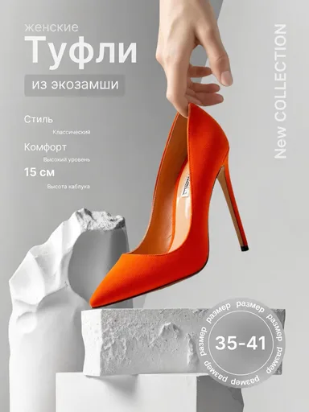

# Шаблон «Скульптурный подиум»

Reference для категории **«Одежда и обувь»** (`cat_fashion`). Миграция `028-fashion-sculpture-template` добавляет шаблон `tpl_fashion_sculpture` с порядком `50` и общим recipe; `029-fashion-sculpture-variants` добавляет десять сценариев серии.

| Параметр | Значение |
| --- | --- |
| Файл для загрузки | `assets/templates/tpl_fashion_sculpture/4a00b821-2689-4390-ab6b-c06e15210c6a.webp` |
| Bucket в MinIO | `user-images` по умолчанию; при заданном `MINIO_BUCKET` использовать его значение |
| Ключ объекта в MinIO | `templates/tpl_fashion_sculpture/4a00b821-2689-4390-ab6b-c06e15210c6a.webp` |
| Content-Type | `image/webp` |
| Размер | `384×512`, `15522` байта (около `15 КиБ`) |
| Asset ID | `asset_tpl_fashion_sculpture_ref` |
| Template ID | `tpl_fashion_sculpture` |
| Recipe и метаданные | [Миграция 028](../../../src/main/resources/db/changelog/changes/028-fashion-sculpture-template.yaml) |
| Варианты 1–10 | [card-variants.json](card-variants.json), [миграция 029](../../../src/main/resources/db/changelog/changes/029-fashion-sculpture-variants.yaml) |

Reference подготовлен из предоставленного пользователем JPEG встроенным ImageGen: удалены похожие на интерфейс метки навигации `01–05` и маленькие стрелки у подписей. Рабочий запрос: «Удалить только нижние левые метки навигации и три стрелки у характеристик; сохранить туфлю, руку, белые скульптуры, подиум, серый фон, освещение, остальную типографику и вертикальную композицию; не добавлять новые объекты или надписи». Результат уменьшен до размера каталога и сохранён в WebP; исходный JPEG в каталоге не хранится.

## Подключение

1. Backend-деплой автоматически синхронизирует WebP в bucket приложения по точному ключу `templates/tpl_fashion_sculpture/4a00b821-2689-4390-ab6b-c06e15210c6a.webp` с Content-Type `image/webp`. В ключ не входят имя bucket и префикс `assets/`.
2. Запустить приложение с Liquibase: миграция `028` добавит asset и шаблон, миграция `029` — десять сценариев.
3. Открыть категорию «Одежда и обувь» или вызвать `GET /api/v1/templates?categoryId=cat_fashion` для просмотра превью.

Туфля, рука, надписи, заявление о материале и комфорте, высота каблука `15 см`, размерный ряд `35–41` и название коллекции относятся только к демонстрационному reference. При генерации товар и наложенный текст заменяются по исходному фото и подтверждённому описанию пользователя; неподтверждённые блоки опускаются. Рука или модель не добавляются, если их нет на исходном фото.
