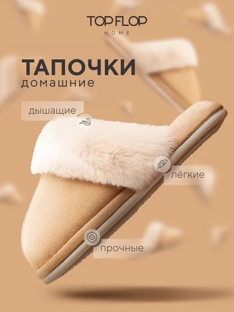

# Шаблон «Тёплый уют»

Новый шаблон `tpl_fashion_soft` категории **«Одежда и обувь»** (`cat_fashion`), порядок `60`. Мягкий персиковый фон, крупный диагональный товар и полупрозрачные плашки сохраняют композицию исходного макета.

| Параметр | Значение |
| --- | --- |
| Template ID | `tpl_fashion_soft` |
| Asset ID | `asset_tpl_fashion_soft_ref` |
| Файл | `assets/templates/tpl_fashion_soft/623c0b3f-7ed0-5699-b2fb-763811f5ebb5.webp` |
| Ключ объекта | `templates/tpl_fashion_soft/623c0b3f-7ed0-5699-b2fb-763811f5ebb5.webp` |
| Content-Type | `image/webp` |
| Размер | `384×512`, `18658` байт |
| Категория / порядок | `cat_fashion` / `60` |
| Recipe | [recipe.json](recipe.json) |
| Метаданные и recipe | [Миграция 078](../../../src/main/resources/db/changelog/changes/078-fashion-footwear-templates.yaml) |
| Сценарии | [card-variants.json](card-variants.json), [миграция 079](../../../src/main/resources/db/changelog/changes/079-fashion-footwear-variants.yaml) |

Reference детерминированно перекодирован из предоставленного JPEG `53c80151837ff75d265c04677964f847.jpg`: RGB, LANCZOS до 384×512, WebP quality=86, method=6; исходный макет сохранён. UUID v5 получен от строки `tovarika:tpl_fashion_soft:53c80151837ff75d265c04677964f847:v1`. Исходный тяжёлый файл не хранится в каталоге.

Надписи и бренд на макете описывают демонстрационный товар. При генерации они заменяются подтверждёнными сведениями пользователя; заявления о дыхании материала, лёгкости и прочности не наследуются. Палитра задаёт фон и декор, сохраняя исходный цвет товара. Детальные сценарии используют только различимые участки исходного фото, иначе показывают товар целиком.

## Десять сценариев

| № | Название | Кадрирование | Композиция |
| --- | --- | --- | --- |
| 1 | Обложка | Товар целиком | Товар целиком по диагонали из нижнего левого угла к правой верхней части; название и подзаголовок в верхней левой зоне, полупрозрачные плашки с круглыми значками вдоль свободных краёв. |
| 2 | Коротко о главном | Товар целиком | Исходный товар целиком справа; слева заголовок и вертикальная колонка полупрозрачных кремовых плашек с лаконичными подписями и тонкими значками. |
| 3 | Фактура вблизи | Деталь с запасным общим видом | Различимый участок фактуры занимает нижнюю правую часть; сверху слева крупный заголовок, снизу слева одна полупрозрачная плашка без списка характеристик. |
| 4 | Линии и силуэт | Товар целиком | Товар целиком в центре вертикального кадра с большим свободным полем; крупный заголовок снизу, до двух коротких тонких выносок к видимым линиям силуэта. |
| 5 | Деталь конструкции | Деталь с запасным общим видом | Одна различимая деталь конструкции крупно слева; справа короткий тёмный заголовок и одна кремовая плашка, мягкий персиковый фон остаётся свободным. |
| 6 | Подтверждённые размеры | Товар целиком | Товар целиком в верхней центральной зоне; снизу заголовок и компактная сетка полупрозрачных плашек с подтверждёнными размерными данными. |
| 7 | Цвет и отделка | Товар целиком | Товар целиком слева, справа два разнесённых кремовых текстовых блока о подтверждённых цвете и отделке; компактный заголовок наверху справа. |
| 8 | Видимая маркировка | Деталь с запасным общим видом | Различимая маркировка или принт крупно в центре; заголовок сверху и одна узкая кремовая подпись снизу на мягком персиковом фоне. |
| 9 | Уход по инструкции | Товар целиком | Товар целиком в нижней трети на мягкой тени; сверху крупный заголовок и горизонтальный ряд кремовых плашек с подтверждёнными правилами ухода. |
| 10 | Спокойный финал | Товар целиком | Товар целиком по центру на тёплом фоне, мягкая овальная тень снизу; компактное название сверху, одна широкая полупрозрачная плашка под товаром. |

## Подключение и проверка

Backend-деплой синхронизирует WebP в MinIO по указанному ключу с Content-Type `image/webp` до запуска Liquibase. Миграция 078 добавляет метаданные и recipe четырёх шаблонов, 079 добавляет сценарии. В ключ не входят `assets/` и имя bucket. Подготовка файлов не применяет миграции, не загружает объекты и не запускает деплой.

Локальная проверка: `python3 scripts/seed-card-variants.py --check --source assets/templates/tpl_fashion_soft/card-variants.json`. После штатного деплоя проверить превью в категории «Одежда и обувь» и генерацию по собственному фото для `1:1`, `3:4`, `4:5`, `16:9`: замена демонстрационного товара и надписей, сохранение исходных цветов и отсутствие выдуманных сведений.
