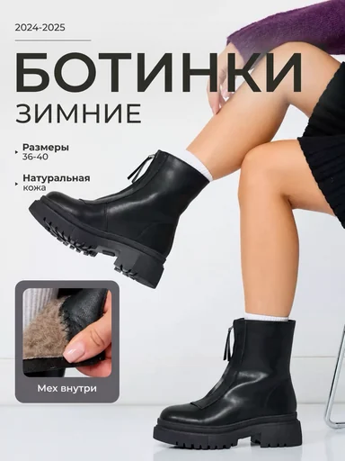

# Шаблон «Зимний акцент»

Reference для категории **«Одежда и обувь»** (`cat_fashion`). Новый шаблон `tpl_fashion_winter`, порядок `90`: светлый студийный фон, крупный тёмный заголовок, короткие фактические подписи и скруглённая вставка детали.

| Параметр | Значение |
| --- | --- |
| Template ID | `tpl_fashion_winter` |
| Asset ID | `asset_tpl_fashion_winter_ref` |
| Файл | `assets/templates/tpl_fashion_winter/91507601-407d-4b1b-bd6f-4b4184049551.webp` |
| Ключ объекта | `templates/tpl_fashion_winter/91507601-407d-4b1b-bd6f-4b4184049551.webp` |
| Content-Type | `image/webp` |
| Размер | `384×512`, `20710` байт |
| Категория / порядок | `cat_fashion` / `90` |
| Recipe | [recipe.json](recipe.json) |
| Метаданные и recipe | [Миграция 078](../../../src/main/resources/db/changelog/changes/078-fashion-footwear-templates.yaml) |
| Сценарии | [card-variants.json](card-variants.json), [миграция 079](../../../src/main/resources/db/changelog/changes/079-fashion-footwear-variants.yaml) |

Reference подготовлен из предоставленного JPEG `e637ab9c9316ee82659a00d2781a794d.jpg` встроенным ImageGen. Рабочий запрос: «Удалить только три точки карусели снизу слева и круг со знаком увеличения в углу вставки меха; восстановить фон под ними, сохранить оба ботинка, модель, позу, кресло, светлый фон, вставку детали, русские надписи и исходную вертикальную композицию». Результат уменьшен до `384×512`, WebP quality=86, method=6. Исходный тяжёлый файл в каталоге не хранится.

Название стиля относится к оформлению. Демонстрационные ботинки, модель, даты, размерный ряд, натуральная кожа, мех и сезонность не переносятся на товар пользователя. Наложенный текст заменяется только подтверждёнными сведениями. Модель допустима только при её наличии на исходном фото; скрытая внутренняя часть и неразличимые детали заменяются видом товара целиком. Палитра относится к фону и графике, сохраняя реальные цвета товара.

## Десять сценариев

| № | Название | Кадрирование |
| --- | --- | --- |
| 1 | Обложка | Товар целиком |
| 2 | Силуэт | Товар целиком |
| 3 | Фактура поверхности | Деталь с запасным общим видом |
| 4 | Видимая конструкция | Деталь с запасным общим видом |
| 5 | Внутренняя деталь | Деталь с запасным общим видом |
| 6 | Подтверждённые размеры | Товар целиком |
| 7 | Особенности | Товар целиком |
| 8 | Уход | Товар целиком |
| 9 | Маркировка | Деталь с запасным общим видом |
| 10 | Итоговая карточка | Товар целиком |

## Подключение и проверка

Backend-деплой синхронизирует WebP в MinIO по точному ключу с Content-Type `image/webp` до запуска Liquibase. В ключ не входят `assets/` и имя bucket. Общая миграция `078` добавляет метаданные четырёх шаблонов, `079` — их 40 сценариев. Подготовка файлов не применяет миграции и не загружает объекты вручную.

Локальная проверка: `python3 scripts/seed-card-variants.py --check --source assets/templates/tpl_fashion_winter/card-variants.json`.
После штатного backend-деплоя проверить превью через `GET /api/v1/templates?categoryId=cat_fashion` и генерацию для `1:1`, `3:4`, `4:5`, `16:9`: замену демонстрационного товара и текста, сохранение цвета и геометрии исходного товара, отсутствие выдуманных свойств.
