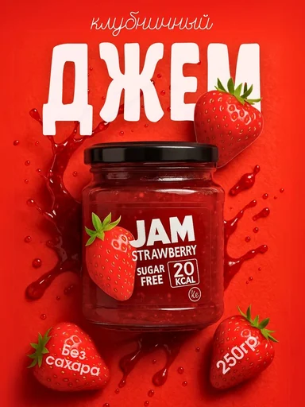

# Шаблон «Food color»

Готовый reference для существующего `tpl_food_accent` в категории **«Еда и напитки»** (`cat_food`, `sort_order=20`). Миграции `056-food-color-template` и `057-food-color-variants` связывают изображение, recipe и десять сценариев с шаблоном, сохраняя его категорию и порядок.

| Параметр | Значение |
| --- | --- |
| Файл для загрузки | `assets/templates/tpl_food_accent/d5afe416-9503-430b-b39f-47187eabf0f7.webp` |
| Bucket в MinIO | `user-images` по умолчанию; если задан `MINIO_BUCKET`, использовать его значение |
| Ключ объекта в MinIO | `templates/tpl_food_accent/d5afe416-9503-430b-b39f-47187eabf0f7.webp` |
| Content-Type | `image/webp` |
| Размер | `384×512`, `33064` байта (около `32,3 КиБ`) |
| Asset ID | `asset_tpl_food_accent_ref` |
| Template ID | `tpl_food_accent` |
| Recipe и метаданные | [Миграция 056](../../../src/main/resources/db/changelog/changes/056-food-color-template.yaml) |
| Варианты 1–10 | [card-variants.json](card-variants.json), [миграция 057](../../../src/main/resources/db/changelog/changes/057-food-color-variants.yaml) |

Изображение получено из предоставленного пользователем JPG: пропорциональное уменьшение до вертикальной карточки и сжатие в WebP с UUID в имени. Оно используется и для превью, и как визуальный образец при генерации. Сцена — насыщенный красный фон, центральная упаковка, брызги и крупная белая типографика.

## Как подключить и проверить

1. До применения миграции загрузить WebP в bucket приложения по точному ключу `templates/tpl_food_accent/d5afe416-9503-430b-b39f-47187eabf0f7.webp` с Content-Type `image/webp`. Префикс `assets/` и имя bucket в ключ не входят.
2. Запустить приложение с Liquibase. Миграция `056` создаст запись `assets` и обновит существующий шаблон; `057` добавит десять вариантов.
3. Открыть категорию «Еда и напитки» или вызвать `GET /api/v1/templates?categoryId=cat_food`; у шаблона «Food color» должно появиться превью.
4. В режиме `OPENAI_MODE=live` проверить генерацию с собственным фото товара. Результат должен сохранить упаковку, реальные цвета, бренд и видимые надписи исходного товара.

Бренд, слово «JAM», клубника, заявление об отсутствии сахара, калорийность и масса относятся только к демонстрационному джему. Их место и типографика показывают верстку; текст и пищевые элементы для товара пользователя допустимы лишь при подтверждении исходным фото или описанием. Если сведений нет, соответствующий блок опускается.
