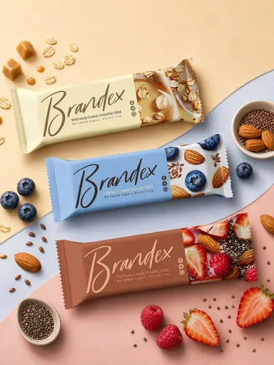

# Шаблон «Food clean»

Reference для существующего `tpl_food_hero` в категории **«Еда и напитки»** (`cat_food`, порядок `10`). Миграция `054-food-clean-template` связывает изображение и обновляет общий recipe; `055-food-clean-variants` добавляет десять сценариев серии.

| Параметр | Значение |
| --- | --- |
| Файл для загрузки | `assets/templates/tpl_food_hero/0bebf79d-d720-4e9b-af2e-82a1dff30944.webp` |
| Bucket в MinIO | `user-images` по умолчанию; при заданном `MINIO_BUCKET` использовать его значение |
| Ключ объекта в MinIO | `templates/tpl_food_hero/0bebf79d-d720-4e9b-af2e-82a1dff30944.webp` |
| Content-Type | `image/webp` |
| Размер | `384×512`, `26580` байт (около `26 КиБ`) |
| Asset ID | `asset_tpl_food_hero_ref` |
| Template ID | `tpl_food_hero` |
| Recipe и метаданные | [Миграция 054](../../../src/main/resources/db/changelog/changes/054-food-clean-template.yaml) |
| Варианты 1–10 | [card-variants.json](card-variants.json), [миграция 055](../../../src/main/resources/db/changelog/changes/055-food-clean-variants.yaml) |

Reference подготовлен из предоставленного JPG. Сохранены три диагонально расположенные демонстрационные упаковки, светлые пастельные поля, мягкие тени и небольшие пищевые акценты. Исходный JPG в каталог не добавлен.

Название и надписи на демонстрационных упаковках, ягоды, орехи и злаки относятся только к образцу. Для товара пользователя модель сохраняет исходную упаковку и её видимую маркировку, а дополнительные подписи заполняет только подтверждёнными сведениями. Три разные упаковки допустимы лишь при наличии подтверждённых вариантов и материалов для каждого. Если вариант один, на карточке показывается один товар, а пастельные диагонали остаются элементом оформления.

## Подключение

1. Backend-деплой автоматически синхронизирует WebP в bucket приложения по точному ключу `templates/tpl_food_hero/0bebf79d-d720-4e9b-af2e-82a1dff30944.webp` с Content-Type `image/webp`. В ключ не входят имя bucket и префикс `assets/`.
2. Подключить `054-food-clean-template.yaml`, затем `055-food-clean-variants.yaml` к master changelog после ранее опубликованных миграций. Порядок включения согласуется с остальными шаблонами категории.
3. Запустить приложение с Liquibase и открыть категорию «Еда и напитки» или вызвать `GET /api/v1/templates?categoryId=cat_food` для просмотра превью.

Миграции идут в порядке `054→055`. Файлы не загружают изображение в MinIO и не применяют изменения к БД сами по себе.
