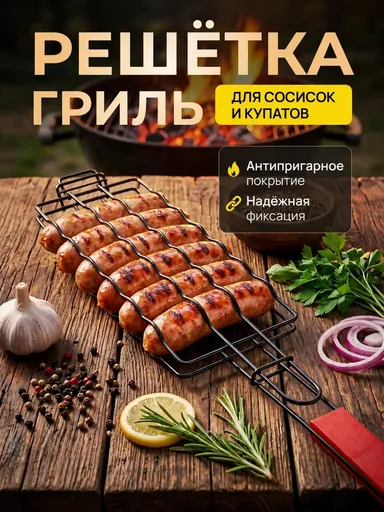

# Шаблон «Kitchen scene»

Reference для категории **«Еда и напитки»** (`cat_food`). Шаблон `tpl_food_lifestyle` создан миграцией `010` с порядком `30`. Миграция `058-kitchen-scene-template` добавляет изображение и общий recipe, `059-kitchen-scene-variants` — десять сценариев серии.

| Параметр | Значение |
| --- | --- |
| Файл для загрузки | `assets/templates/tpl_food_lifestyle/5d8a9ce9-d8a3-49ed-9777-9cdd3c1d5bb0.webp` |
| Bucket в MinIO | `user-images` по умолчанию; при заданном `MINIO_BUCKET` использовать его значение |
| Ключ объекта в MinIO | `templates/tpl_food_lifestyle/5d8a9ce9-d8a3-49ed-9777-9cdd3c1d5bb0.webp` |
| Content-Type | `image/webp` |
| Размер | `384×512`, `48764` байта (около `48 КиБ`) |
| Asset ID | `asset_tpl_food_lifestyle_ref` |
| Template ID | `tpl_food_lifestyle` |
| Recipe и метаданные | [Миграция 058](../../../src/main/resources/db/changelog/changes/058-kitchen-scene-template.yaml) |
| Варианты 1–10 | [card-variants.json](card-variants.json), [миграция 059](../../../src/main/resources/db/changelog/changes/059-kitchen-scene-variants.yaml) |

Reference подготовлен по предоставленному JPG: сохранены деревянная фактура, тёплый свет, крупный светлый заголовок, жёлтая плашка и тёмный блок тезисов. Нижняя рекламная плашка удалена. Исходный JPG в каталог шаблона не помещён.

Демонстрационный товар на reference — решётка для сосисок. При генерации её заменяет продукт пользователя; сохраняются форма, цвет, упаковка, бренд и читаемая маркировка исходного товара. Сосиски, мангал и реквизит показывают настроение сцены, а не состав, комплект или способ приготовления нового продукта. Огонь и гриль допустимы лишь когда соответствуют исходному товару; иначе остаются тёплый кухонный свет и тёмная деревянная поверхность. Утверждения об антипригарности, фиксации и назначении решётки не переносятся. Заголовок, плашка и тезисы заполняются подтверждёнными сведениями, неподтверждённые блоки опускаются.

## Подключение

1. **До применения миграций** загрузить WebP в bucket приложения по точному ключу `templates/tpl_food_lifestyle/5d8a9ce9-d8a3-49ed-9777-9cdd3c1d5bb0.webp` с Content-Type `image/webp`. В ключ не входят имя bucket и префикс `assets/`.
2. Подключить миграции `058` и `059` в конце `db.changelog-master.yaml` после предыдущих миграций каталога; затем запустить приложение с Liquibase.
3. Открыть категорию «Еда и напитки» или вызвать `GET /api/v1/templates?categoryId=cat_food` для просмотра превью.
