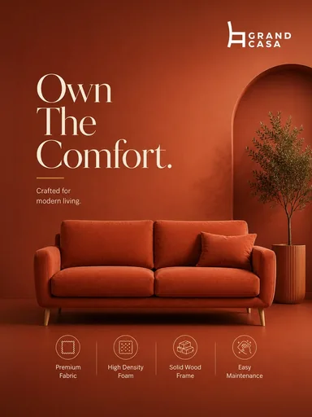

# Шаблон «Tech neon»

Готовый reference для существующего `tpl_home_accent` в категории **«Дом и интерьер»** (`cat_home`, `sort_order=20`). Миграции `050-home-accent-template` и `051-home-accent-variants` связывают изображение, recipe и десять сценариев с шаблоном. Название «Tech neon» сохранено в точности по запросу для этого слота.

| Параметр | Значение |
| --- | --- |
| Файл для загрузки | `assets/templates/tpl_home_accent/ebefbb65-f9ad-4cfa-8a73-f111973745c4.webp` |
| Bucket в MinIO | `user-images` по умолчанию; если задан `MINIO_BUCKET`, использовать его значение |
| Ключ объекта в MinIO | `templates/tpl_home_accent/ebefbb65-f9ad-4cfa-8a73-f111973745c4.webp` |
| Content-Type | `image/webp` |
| Размер | `384×512`, `16330` байт (около `16 КиБ`) |
| Asset ID | `asset_tpl_home_accent_ref` |
| Template ID | `tpl_home_accent` |
| Recipe и метаданные | [Миграция 050](../../../src/main/resources/db/changelog/changes/050-home-accent-template.yaml) |
| Варианты 1–10 | [card-variants.json](card-variants.json), [миграция 051](../../../src/main/resources/db/changelog/changes/051-home-accent-variants.yaml) |

Reference получен из приложенного пользователем JPEG: кадрирование под вертикальную карточку и сжатие в WebP с UUID в имени. Сцена — терракотовая интерьерная студия с арочной нишей, растением, крупным светлым заголовком и основным товаром в центре. Изображение используется для превью и как визуальный образец при генерации.

## Как подключить и проверить

1. До применения миграции загрузить WebP в bucket приложения по точному ключу `templates/tpl_home_accent/ebefbb65-f9ad-4cfa-8a73-f111973745c4.webp` с Content-Type `image/webp`. Префикс `assets/` и имя bucket в ключ не входят.
2. Запустить приложение с Liquibase. Миграция `050` создаст запись `assets` и обновит существующий шаблон; `051` добавит десять вариантов.
3. Открыть категорию «Дом и интерьер» или вызвать `GET /api/v1/templates?categoryId=cat_home`; у шаблона «Tech neon» должно появиться превью.
4. В режиме `OPENAI_MODE=live` проверить генерацию с собственным фото товара. Результат должен сохранить форму, реальные цвета, бренд и видимые надписи исходного товара.

Бренд Grand Casa, слоган, утверждения о ткани, наполнителе, каркасе и уходе, а также значки на reference относятся только к демонстрационному дивану. Их расположение показывает вёрстку; текст для товара пользователя берётся лишь из его исходного фото и подтверждённого описания. Если сведений нет, соответствующий блок опускается.
