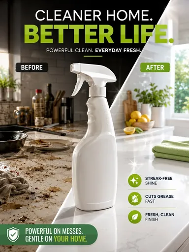

# Шаблон «Home clean»

Reference для существующего `tpl_home_hero` в категории **«Дом и интерьер»** (`cat_home`, порядок `10`). Миграция `048-home-clean-template` связывает изображение и обновляет общий recipe; `049-home-clean-variants` добавляет десять сценариев серии.

| Параметр | Значение |
| --- | --- |
| Файл для загрузки | `assets/templates/tpl_home_hero/fadb3777-0223-49b3-acdf-a7450a1b57d5.webp` |
| Bucket в MinIO | `user-images` по умолчанию; при заданном `MINIO_BUCKET` использовать его значение |
| Ключ объекта в MinIO | `templates/tpl_home_hero/fadb3777-0223-49b3-acdf-a7450a1b57d5.webp` |
| Content-Type | `image/webp` |
| Размер | `384×512`, `30942` байта (около `30 КиБ`) |
| Asset ID | `asset_tpl_home_hero_ref` |
| Template ID | `tpl_home_hero` |
| Recipe и метаданные | [Миграция 048](../../../src/main/resources/db/changelog/changes/048-home-clean-template.yaml) |
| Варианты 1–10 | [card-variants.json](card-variants.json), [миграция 049](../../../src/main/resources/db/changelog/changes/049-home-clean-variants.yaml) |

Reference подготовлен из предоставленного JPG. В нём сохранены центральное размещение товара, диагональное разделение кухонного фона, крупный заголовок, компактные подписи и зелёные акценты. Исходный JPG в каталог не добавлен.

Демонстрационная бутылка, слоганы, подписи «Before» и «After», заявления об удалении загрязнений, блеске и свежести относятся только к образцу. Для товара пользователя они заменяются подтверждёнными сведениями либо опускаются. Реальное сравнение до и после допустимо лишь при наличии двух сопоставимых материалов и подтверждённого результата; иначе используется единая кухонная сцена без сравнительных подписей. Форма, цвет, бренд и видимая маркировка исходного товара сохраняются.

## Подключение

1. Backend-деплой автоматически синхронизирует WebP в bucket приложения по точному ключу `templates/tpl_home_hero/fadb3777-0223-49b3-acdf-a7450a1b57d5.webp` с Content-Type `image/webp`. В ключ не входят имя bucket и префикс `assets/`.
2. Запустить приложение с Liquibase: миграция `048` добавит asset и обновит существующий шаблон, миграция `049` добавит десять сценариев.
3. Открыть категорию «Дом и интерьер» или вызвать `GET /api/v1/templates?categoryId=cat_home` для просмотра превью.

Миграции должны идти в порядке `048→049` после серии `030–047`; порядок включения в master changelog согласуется с остальными шаблонами категории.
