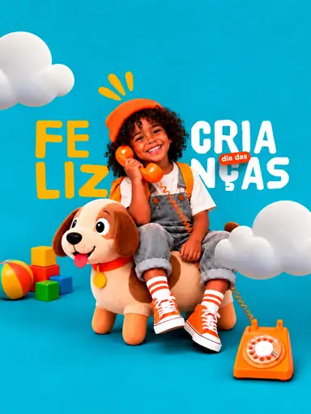

# Шаблон «Kids playful»

Готовый reference для существующего `tpl_kids_accent` в категории **«Детские товары»** (`cat_kids`, `sort_order=20`). Миграции `062-kids-playful-template` и `063-kids-playful-variants` связывают изображение, recipe и десять сценариев с шаблоном, сохраняя его категорию и порядок.

| Параметр | Значение |
| --- | --- |
| Файл для загрузки | `assets/templates/tpl_kids_accent/84f15ca8-1466-4c5a-88a9-c58c9d171d44.webp` |
| Bucket в MinIO | `user-images` по умолчанию; если задан `MINIO_BUCKET`, использовать его значение |
| Ключ объекта в MinIO | `templates/tpl_kids_accent/84f15ca8-1466-4c5a-88a9-c58c9d171d44.webp` |
| Content-Type | `image/webp` |
| Размер | `384×512`, `18684` байта (около `18,2 КиБ`) |
| Asset ID | `asset_tpl_kids_accent_ref` |
| Template ID | `tpl_kids_accent` |
| Recipe и метаданные | [Миграция 062](../../../src/main/resources/db/changelog/changes/062-kids-playful-template.yaml) |
| Варианты 1–10 | [card-variants.json](card-variants.json), [миграция 063](../../../src/main/resources/db/changelog/changes/063-kids-playful-variants.yaml) |

Изображение получено из предоставленного пользователем PNG: центрированная обрезка до пропорции `3:4`, уменьшение и сжатие в WebP с UUID в имени. Оно служит превью и визуальным образцом при генерации. Стиль — яркий бирюзовый фон, мягкие облака, округлая бело-жёлтая типографика и оранжевые акценты.

## Как подключить и проверить

1. Backend-деплой автоматически синхронизирует WebP в bucket приложения по точному ключу `templates/tpl_kids_accent/84f15ca8-1466-4c5a-88a9-c58c9d171d44.webp` с Content-Type `image/webp`. Префикс `assets/` и имя bucket в ключ не входят.
2. Запустить приложение с Liquibase. Миграция `062` создаст запись `assets` и обновит существующий шаблон; `063` добавит десять вариантов.
3. Открыть категорию «Детские товары» или вызвать `GET /api/v1/templates?categoryId=cat_kids`; у шаблона «Kids playful» должно появиться превью.
4. В режиме `OPENAI_MODE=live` проверить генерацию с собственным фото товара. Результат должен сохранить форму, реальные цвета, бренд и видимые надписи исходного товара.

Ребёнок, телефон, дополнительные игрушки и португальские надписи на reference относятся только к демонстрационной сцене. Они не являются обязательными для нового товара. Надписи, возрастные указания и свойства нового товара допустимы лишь при подтверждении исходным фото или описанием; неподтверждённый блок опускается.
