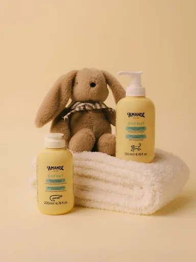

# Шаблон «Kids clean»

Reference для существующего `tpl_kids_hero` в категории **«Детские товары»** (`cat_kids`, порядок `10`). Миграция `060-kids-clean-template` связывает изображение и обновляет общий recipe; `061-kids-clean-variants` добавляет десять сценариев серии.

| Параметр | Значение |
| --- | --- |
| Файл для загрузки | `assets/templates/tpl_kids_hero/dac94340-4df4-454f-b4ea-8715c7384f2f.webp` |
| Bucket в MinIO | `user-images` по умолчанию; при заданном `MINIO_BUCKET` использовать его значение |
| Ключ объекта в MinIO | `templates/tpl_kids_hero/dac94340-4df4-454f-b4ea-8715c7384f2f.webp` |
| Content-Type | `image/webp` |
| Размер | `384×512`, `10142` байта (около `10 КиБ`) |
| Asset ID | `asset_tpl_kids_hero_ref` |
| Template ID | `tpl_kids_hero` |
| Recipe и метаданные | [Миграция 060](../../../src/main/resources/db/changelog/changes/060-kids-clean-template.yaml) |
| Варианты 1–10 | [card-variants.json](card-variants.json), [миграция 061](../../../src/main/resources/db/changelog/changes/061-kids-clean-variants.yaml) |

Reference подготовлен из предоставленного JPG: тёплый бежевый фон, мягкий рассеянный свет, свободное поле и спокойная предметная композиция. Исходный JPG в каталог не добавлен.

Флаконы, видимый бренд, полотенце и плюшевый заяц служат только образцом оформления. Для нового товара сохраняются его собственные форма, цвета и маркировка. Не следует приписывать ему возраст, состав, назначение, свойства или комплектацию на основании reference. Подписи появляются только при подтверждении описанием или читаемой маркировкой товара.

## Подключение

1. **До применения миграций** загрузить WebP в bucket приложения по точному ключу `templates/tpl_kids_hero/dac94340-4df4-454f-b4ea-8715c7384f2f.webp` с Content-Type `image/webp`. В ключ не входят имя bucket и префикс `assets/`.
2. Подключить `060-kids-clean-template.yaml`, затем `061-kids-clean-variants.yaml` к master changelog после ранее опубликованных миграций.
3. Запустить приложение с Liquibase и открыть категорию «Детские товары» или вызвать `GET /api/v1/templates?categoryId=cat_kids` для просмотра превью.

Миграции идут в порядке `060→061`. Файлы не загружают изображение в MinIO и не применяют изменения к БД сами по себе.
