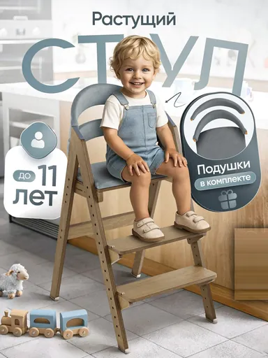

# Шаблон «Kids room»

Reference для категории **«Детские товары»** (`cat_kids`). Шаблон `tpl_kids_lifestyle` создан миграцией `010` с порядком `30`. Миграция `064-kids-room-template` добавляет изображение и общий recipe, `065-kids-room-variants` — десять сценариев серии.

| Параметр | Значение |
| --- | --- |
| Файл для загрузки | `assets/templates/tpl_kids_lifestyle/d434b4f9-366f-43e2-a2fa-bc374afdc2ee.webp` |
| Bucket в MinIO | `user-images` по умолчанию; при заданном `MINIO_BUCKET` использовать его значение |
| Ключ объекта в MinIO | `templates/tpl_kids_lifestyle/d434b4f9-366f-43e2-a2fa-bc374afdc2ee.webp` |
| Content-Type | `image/webp` |
| Размер | `384×512`, `26394` байта (около `26 КиБ`) |
| Asset ID | `asset_tpl_kids_lifestyle_ref` |
| Template ID | `tpl_kids_lifestyle` |
| Recipe и метаданные | [Миграция 064](../../../src/main/resources/db/changelog/changes/064-kids-room-template.yaml) |
| Варианты 1–10 | [card-variants.json](card-variants.json), [миграция 065](../../../src/main/resources/db/changelog/changes/065-kids-room-variants.yaml) |

Reference подготовлен по предоставленному JPG: сохранены светлая домашняя сцена, крупный приглушённо-голубой заголовок за товаром и округлые боковые плашки. Декоративная нумерация справа удалена. Исходный JPG в каталог шаблона не помещён.

Демонстрационный товар — растущий стул с ребёнком в кадре. При генерации его заменяет продукт пользователя с сохранением формы, цвета, упаковки, бренда и видимой маркировки. Ребёнок, игрушки и комнатный реквизит допустимы лишь как уместное окружение и не должны представляться частью комплекта. Заявления «до 11 лет» и «подушки в комплекте», а также возраст, назначение и свойства стула нельзя переносить без подтверждения для товара пользователя. Заголовок и боковые плашки заполняются только проверенными сведениями; неподтверждённые блоки опускаются. Декоративную нумерацию страниц не воспроизводить.

## Подключение

1. **До применения миграций** загрузить WebP в bucket приложения по точному ключу `templates/tpl_kids_lifestyle/d434b4f9-366f-43e2-a2fa-bc374afdc2ee.webp` с Content-Type `image/webp`. В ключ не входят имя bucket и префикс `assets/`.
2. Подключить миграции `064` и `065` в конце `db.changelog-master.yaml` после `063`, затем запустить приложение с Liquibase.
3. Открыть категорию «Детские товары» или вызвать `GET /api/v1/templates?categoryId=cat_kids` для просмотра превью.
