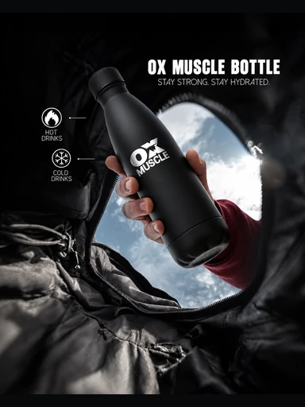

# Шаблон «Sport energy»

Reference для категории **«Спорт и отдых»** (`cat_sport`). Существующий в каталоге шаблон `tpl_sport_accent` имеет порядок `20`. Миграция `074-sport-energy-template` связывает его с reference и общим recipe; миграция `075-sport-energy-variants` добавляет десять сценариев.



| Параметр | Значение |
| --- | --- |
| Файл для загрузки | `assets/templates/tpl_sport_accent/5699c78d-2be2-4234-a62e-05222ef8f3b2.webp` |
| Ключ объекта в MinIO | `templates/tpl_sport_accent/5699c78d-2be2-4234-a62e-05222ef8f3b2.webp` |
| Content-Type | `image/webp` |
| Размер | `384×512`, `27914` байта |
| Asset ID | `asset_tpl_sport_accent_ref` |
| Template ID | `tpl_sport_accent` |
| Recipe и метаданные | [Миграция 074](../../../src/main/resources/db/changelog/changes/074-sport-energy-template.yaml) |
| Варианты 1–10 | [card-variants.json](card-variants.json), [миграция 075](../../../src/main/resources/db/changelog/changes/075-sport-energy-variants.yaml) |

Reference преобразован из исправленного пользователем PNG. Сохранены заголовок `OX MUSCLE BOTTLE`, слоган, подписи и значки для горячих и холодных напитков, а также логотип на бутылке. В этом PNG уже отсутствуют нижний рекламный абзац, телефон и адрес сайта. Весь кадр помещён в `384×512` с небольшими тёмными полями сверху и снизу. В готовой карточке товар и подтверждённые надписи берутся из фото и описания пользователя, а не из демонстрационного reference.

## Общий recipe

```json
{
  "schemaVersion": 1,
  "scene": "Dark outdoor jacket texture with a cool sky opening; the source product is the dominant foreground subject",
  "composition": "Full source product centered on a diagonal; dark space at top right for a bold heading and small factual callouts",
  "lighting": "Directional natural light from the sky opening, with soft highlights on the product and deep surrounding shadows",
  "style": "High-contrast sports editorial card with condensed white heading and restrained feature labels sourced only from user data",
  "palette": ["#08090B", "#303236", "#A9C5D9", "#F4F6F4", "#852B3D"],
  "avoid": [
    "reference bottle, hand, logos or advertising copy",
    "reference phone number, website or contact details",
    "invented product features, dimensions, prices or claims",
    "changes to source product geometry, colors or branding",
    "people or hands absent from the source image"
  ]
}
```

## Проверка

Backend-деплой синхронизирует WebP по точному ключу перед применением Liquibase. После миграций открыть шаблон в категории «Спорт и отдых» и проверить генерацию на исходных товарах с разной формой и поддерживаемыми соотношениями сторон. Заголовки и подписи должны опираться только на подтверждённые сведения; демонстрационный слоган и бренд не копируются автоматически.
