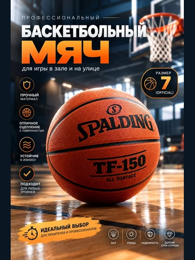

# Шаблон «Sport studio»

Reference для категории **«Спорт и отдых»** (`cat_sport`). Шаблон `tpl_sport_hero` создан миграцией `010` с порядком `10`. [Миграция 072](../../../src/main/resources/db/changelog/changes/072-sport-studio-template.yaml) добавляет reference и общий recipe, [миграция 073](../../../src/main/resources/db/changelog/changes/073-sport-studio-variants.yaml) — десять сценариев из [card-variants.json](card-variants.json).



| Параметр | Значение |
| --- | --- |
| Файл для загрузки | `assets/templates/tpl_sport_hero/de104448-b8d0-46f5-8f76-b4fbb43e8f7e.webp` |
| Ключ объекта в MinIO | `templates/tpl_sport_hero/de104448-b8d0-46f5-8f76-b4fbb43e8f7e.webp` |
| Content-Type | `image/webp` |
| Размер | `384×512`, `58552` байт (около `57 КиБ`) |
| Asset ID | `asset_tpl_sport_hero_ref` |
| Template ID | `tpl_sport_hero` |

Reference преобразован из исходного JPG без удаления надписей. Сохранены крупный заголовок, заявления о свойствах, размерная плашка, нижняя рекламная лента, пиктограммы, бренд на мяче, кольцо, тёмный зал и деревянный пол. Чтобы поместить весь вертикальный макет в `384×512` без обрезки текста, добавлены узкие тёмные поля по бокам. Исходный JPG в каталог шаблона не помещён.

## Общий recipe для миграции

```json
{
  "schemaVersion": 1,
  "scene": "Indoor basketball court with dark navy gym background and polished wooden floor",
  "composition": "Source product large in lower center; oversized headline above, side fact icons, a round badge and a narrow bottom ribbon when verified",
  "lighting": "Cool overhead sports lighting, warm floor reflections and crisp highlights on product texture",
  "style": "High-contrast sports infographic with bold white and orange type, outlined fact icons and a painted orange bottom ribbon",
  "palette": ["#0A1B2A", "#263B4A", "#EF6A2A", "#F5F7F8", "#B6814C"],
  "avoid": [
    "verbatim reference copy or demonstration branding",
    "invented specifications, prices or performance claims",
    "phone numbers, web addresses or promotional calls to action",
    "unrelated equipment or unsupported product views",
    "changes to source product identity, color or visible branding"
  ]
}
```

Для генерации демонстрационный мяч заменяется исходным товаром пользователя. Спортзал и кольцо — окружение, а не часть товара или комплекта; для неподходящего спортивного товара окружение можно упростить. Название и факультативные текстовые блоки заполняются только подтверждёнными сведениями. Надписи на самом товаре пользователя сохраняются, реклама из исходного JPG не переносится.

## Подключение

Backend-деплой синхронизирует WebP в bucket приложения по точному ключу `templates/tpl_sport_hero/de104448-b8d0-46f5-8f76-b4fbb43e8f7e.webp` с Content-Type `image/webp` до запуска Liquibase. В ключ не входят имя bucket и префикс `assets/`. После подключения миграций проверить превью через `GET /api/v1/templates?categoryId=cat_sport`.
