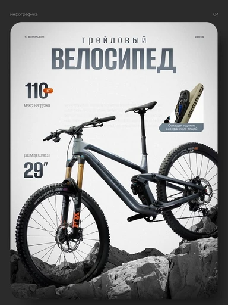

# Шаблон «Outdoor sport»

Reference для категории **«Спорт и отдых»** (`cat_sport`). Существующий в каталоге шаблон `tpl_sport_lifestyle` имеет порядок `30`. Миграция `076-sport-outdoor-template` добавляет reference и recipe; `077-sport-outdoor-variants` добавляет десять сценариев.

| Параметр | Значение |
| --- | --- |
| Файл для загрузки | `assets/templates/tpl_sport_lifestyle/f5169f2e-e223-4869-9c44-8935adfc052f.webp` |
| Ключ объекта в MinIO | `templates/tpl_sport_lifestyle/f5169f2e-e223-4869-9c44-8935adfc052f.webp` |
| Content-Type | `image/webp` |
| Размер | `384×512`, `37670` байт |
| Asset ID | `asset_tpl_sport_lifestyle_ref` |
| Template ID | `tpl_sport_lifestyle` |
| Recipe и метаданные | [миграция 076](../../../src/main/resources/db/changelog/changes/076-sport-outdoor-template.yaml) |
| Варианты 1–10 | [card-variants.json](card-variants.json), [миграция 077](../../../src/main/resources/db/changelog/changes/077-sport-outdoor-variants.yaml) |

Reference преобразован из предоставленного JPEG без удаления надписей. Сохранены слова «инфографика» и «04», марки в верхних углах, на раме и вилке, заголовок, технические подписи, велосипед и каменистый фон. Исходный кадр уменьшен до каталожного размера и сохранён в WebP.

Backend-деплой синхронизирует WebP в bucket приложения по указанному ключу до применения Liquibase. После запуска приложения превью доступно в категории «Спорт и отдых» или через `GET /api/v1/templates?categoryId=cat_sport`.

Велосипед, значения `110 кг` и `29″`, аксессуар и все подписи относятся только к демонстрационному reference. При генерации товар и наложенный текст заменяются по исходному фото и подтверждённому описанию пользователя; неподтверждённые блоки опускаются.
