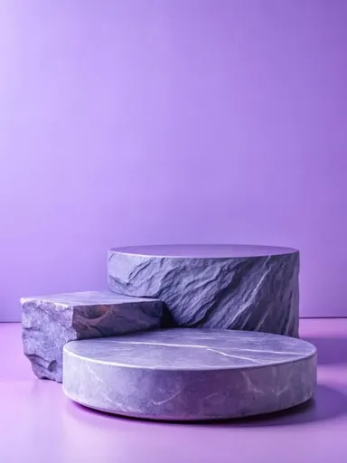

# Шаблон «Цветовой акцент»

Готовый reference для существующего `tpl_universal_accent` в категории **«Универсальные»** (`cat_universal`). Миграции `032-universal-accent-template` и `033-universal-accent-variants` связывают изображение, recipe и десять сценариев с шаблоном, сохраняя его категорию и порядок.

| Параметр | Значение |
| --- | --- |
| Файл для загрузки | `assets/templates/tpl_universal_accent/23a5bff8-4f51-49f7-ae71-98f16f1f2b9a.webp` |
| Bucket в MinIO | `user-images` по умолчанию; если задан `MINIO_BUCKET`, использовать его значение |
| Ключ объекта в MinIO | `templates/tpl_universal_accent/23a5bff8-4f51-49f7-ae71-98f16f1f2b9a.webp` |
| Content-Type | `image/webp` |
| Размер | `384×512`, `8870` байт (около `8,7 КиБ`) |
| Asset ID | `asset_tpl_universal_accent_ref` |
| Template ID | `tpl_universal_accent` |
| Recipe и метаданные | [Миграция 032](../../../src/main/resources/db/changelog/changes/032-universal-accent-template.yaml) |
| Варианты 1–10 | [card-variants.json](card-variants.json), [миграция 033](../../../src/main/resources/db/changelog/changes/033-universal-accent-variants.yaml) |

Reference подготовлен из пользовательского JPEG: центральный фрагмент кадра уменьшен до размера каталога и сохранён в WebP с UUID в имени. На снимке нет демонстрационного товара или надписей. При генерации исходный товар пользователя размещается на каменном подиуме; фиолетовый свет и палитра относятся только к сцене.

## Как подключить и проверить

1. Backend-деплой автоматически синхронизирует указанный WebP в bucket приложения по точному ключу `templates/tpl_universal_accent/23a5bff8-4f51-49f7-ae71-98f16f1f2b9a.webp`. Префикс `assets/` и имя bucket в ключ не входят.
2. Запустить приложение с Liquibase. Миграция `032` создаст запись `assets` и обновит существующий шаблон; `033` добавит десять вариантов.
3. Открыть категорию «Универсальные» или вызвать `GET /api/v1/templates?categoryId=cat_universal`; у шаблона «Цветовой акцент» должно появиться превью.
4. В режиме `OPENAI_MODE=live` проверить генерацию с собственным фото товара. Результат должен сохранять форму, реальные цвета, маркировку и другие видимые детали исходного товара.

Цвет камня и фона на reference не задаёт расцветки товара. Текст на карточке допускается только из подтверждённых сведений пользователя; пустые информационные блоки опускаются.
