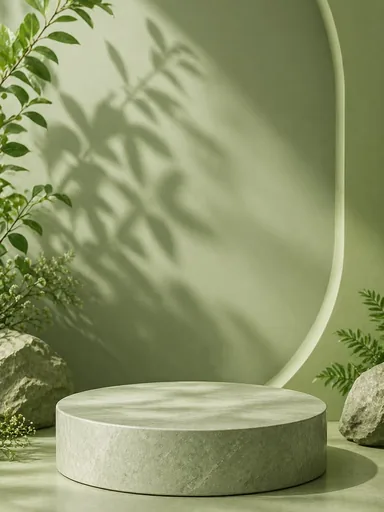

# Шаблон «Чистый фон»

Reference для существующего `tpl_universal_hero` в категории **«Универсальные»** (`cat_universal`, порядок `10`). Миграция `030-universal-hero-template` привязывает изображение и обновляет общий recipe; `031-universal-hero-variants` добавляет десять сценариев серии.

| Параметр | Значение |
| --- | --- |
| Файл для загрузки | `assets/templates/tpl_universal_hero/72865f01-a3b3-4ad4-a575-89dd885edeb8.webp` |
| Bucket в MinIO | `user-images` по умолчанию; при заданном `MINIO_BUCKET` использовать его значение |
| Ключ объекта в MinIO | `templates/tpl_universal_hero/72865f01-a3b3-4ad4-a575-89dd885edeb8.webp` |
| Content-Type | `image/webp` |
| Размер | `384×512`, `17196` байт (около `17 КиБ`) |
| Asset ID | `asset_tpl_universal_hero_ref` |
| Template ID | `tpl_universal_hero` |
| Recipe и метаданные | [Миграция 030](../../../src/main/resources/db/changelog/changes/030-universal-hero-template.yaml) |
| Варианты 1–10 | [card-variants.json](card-variants.json), [миграция 031](../../../src/main/resources/db/changelog/changes/031-universal-hero-variants.yaml) |

Reference уменьшен из предоставленного пользователем JPEG и сохранён в WebP с UUID в имени файла. Исходный JPEG в каталог шаблона не добавлен. Светлый круглый подиум остаётся пустым в самом reference: при генерации на него помещается исходный товар пользователя. Оливковая ниша, растения и мягкие тени создают чистое пространство вокруг товара и не должны перекрывать его.

## Подключение

1. Backend-деплой автоматически синхронизирует WebP в bucket приложения по точному ключу `templates/tpl_universal_hero/72865f01-a3b3-4ad4-a575-89dd885edeb8.webp` с Content-Type `image/webp`. В ключ не входят имя bucket и префикс `assets/`.
2. Запустить приложение с Liquibase: миграция `030` добавит asset и обновит существующий шаблон, миграция `031` добавит десять сценариев.
3. Открыть категорию «Универсальные» или вызвать `GET /api/v1/templates?categoryId=cat_universal` для просмотра превью.

Цвет подиума и фона относится к оформлению, а не к товару. При генерации сохраняются реальные форма, цвет, бренд и видимые надписи исходного товара. Текстовые подписи добавляются только по подтверждённым сведениям из его фото и описания; недоступные детали и ракурсы не выдумываются.
