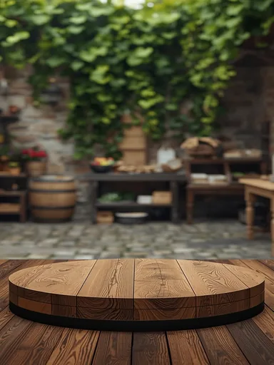

# Шаблон «Лёгкий lifestyle»

Reference для категории **«Универсальные»** (`cat_universal`). Шаблон `tpl_universal_lifestyle` создан миграцией `010` с порядком `30`. Миграция `034-universal-lifestyle-template` добавляет reference и общий recipe; `035-universal-lifestyle-variants` добавляет десять сценариев серии.

| Параметр | Значение |
| --- | --- |
| Файл для загрузки | `assets/templates/tpl_universal_lifestyle/0ed156b9-b0ba-4ec6-a7b0-2e9535e18790.webp` |
| Bucket в MinIO | `user-images` по умолчанию; при заданном `MINIO_BUCKET` использовать его значение |
| Ключ объекта в MinIO | `templates/tpl_universal_lifestyle/0ed156b9-b0ba-4ec6-a7b0-2e9535e18790.webp` |
| Content-Type | `image/webp` |
| Размер | `384×512`, `25484` байта (около `25 КиБ`) |
| Asset ID | `asset_tpl_universal_lifestyle_ref` |
| Template ID | `tpl_universal_lifestyle` |
| Recipe и метаданные | [Миграция 034](../../../src/main/resources/db/changelog/changes/034-universal-lifestyle-template.yaml) |
| Варианты 1–10 | [card-variants.json](card-variants.json), [миграция 035](../../../src/main/resources/db/changelog/changes/035-universal-lifestyle-variants.yaml) |

Reference уменьшен из предоставленного пользователем JPEG до размера каталога и сохранён в WebP. Исходный JPEG в каталоге шаблона не хранится. Пустой деревянный подиум на фоне размытого дворика служит сценой для исходного товара пользователя. Он не задаёт ни тип товара, ни его свойства.

## Подключение

1. Backend-деплой автоматически синхронизирует WebP в bucket приложения по точному ключу `templates/tpl_universal_lifestyle/0ed156b9-b0ba-4ec6-a7b0-2e9535e18790.webp` с Content-Type `image/webp`. В ключ не входят имя bucket и префикс `assets/`.
2. Запустить приложение с Liquibase: миграция `034` обновит шаблон и добавит asset, миграция `035` — десять сценариев.
3. Открыть категорию «Универсальные» или вызвать `GET /api/v1/templates?categoryId=cat_universal` для просмотра превью.

При генерации исходный товар помещается на подиум с сохранением его формы, реальных цветов, бренда и видимых надписей. Текстовые блоки заполняются только подтверждёнными сведениями о товаре; неподтверждённые блоки опускаются. Люди, другие товары, способы применения и невидимые детали не добавляются без основания в исходном фото или описании.
